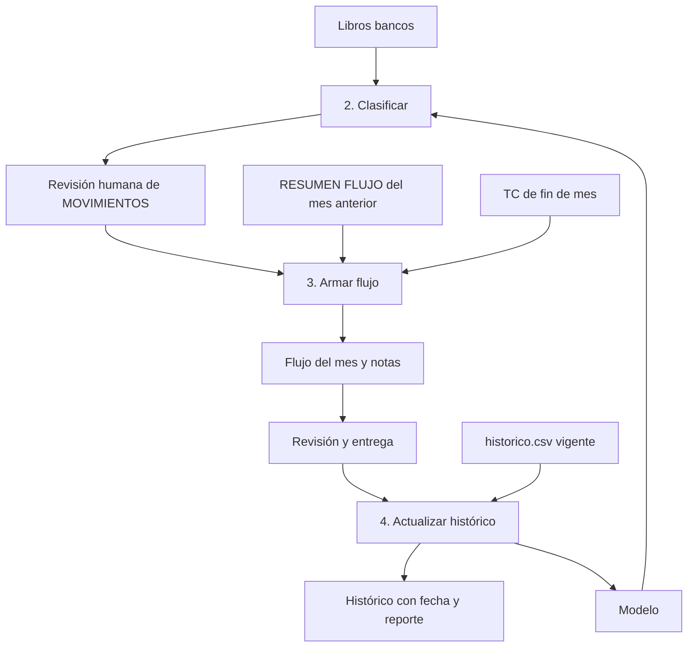

# Arquitectura

## Principios
- **Sin backend.** Todo corre en el navegador con Pyodide. Los archivos nunca salen de la PC.
- **La plantilla se describe sola.** Los vínculos del mes anterior dicen qué sección alimenta cada línea del resumen, así casi no hace falta configuración por empresa.
- **Copia, no reconstrucción.** El flujo nuevo siempre parte de una copia del mes anterior.
- **La lógica vive en Python.** El JavaScript solo hace de puente.

## Proceso mensual

## Paquete `src/flujos`
| Carpeta | Qué hace |
|---|---|
| `lectura/` | Lee libros bancos y flujos cerrados. Normaliza empresas, bancos, monedas, categorías y fechas. |
| `clasificacion/` | Entrena y aplica el modelo, y rehace las hojas por cuenta del Excel clasificado. |
| `armado/` | Analiza la plantilla, reemplaza bloques, traduce fórmulas, rueda TOTAL y hoja mensual, llena Over y FM, y guarda. |
| `validacion/` | Evalúa fórmulas y corre los controles del flujo armado. |
| `historico/` | Valida los flujos entregados y los incorpora por empresa y periodo. |
| `reportes/` | Escribe el Excel clasificado, las notas y el reporte del histórico. |
| `app/web.py` | Puente con la página. Trabaja sobre el sistema de archivos virtual del navegador. |
| `cli.py` | Línea de comandos para desarrollo. |
| `recursos/config.toml` | Empresas, bancos, variantes de categoría, tipos de transferencia y filas de las hojas Over. |

Una configuración local no versionada puede agregarse con la variable `FLUJOS_CONFIG`.

## Clasificador
1. **Memoria:** si un concepto de la misma empresa y tipo fue consistente, se repite su categoría.
2. **Modelo:** regresión logística sobre el texto del concepto, códigos, empresa, banco, moneda y rango de monto. Solo propone categorías que esa empresa ya usó.
3. **Reglas:** el ITF de la misma fila va siempre a ITF. Una fila con un mes distinto al de sus vecinas se cuenta según su ubicación y se marca para revisar.

## Armado
1. `estructura.py` detecta cabecera, secciones, subtotales y totales de cada hoja de banco.
2. `fuentes.py` asigna cuentas del libro a hojas del flujo por banco, moneda y continuidad de saldo, y reparte los movimientos en sus secciones.
3. `reacomodo.py` reemplaza los bloques y devuelve un mapa de filas.
4. `formulas.py` traduce todas las fórmulas con ese mapa, sin cortar rangos ni dejar `#REF!`.
5. `rodar.py` congela la columna del mes anterior en TOTAL, crea la nueva y actualiza TC y rótulos.
6. `overnight.py` empareja cargos y abonos, calcula intereses y llena la hoja Over.
7. `guardar.py` guarda e inyecta los valores calculados en el XML, para que el archivo no se vea vacío en Vista protegida.

## Controles del armado
- Saldo final de cada cuenta contra el libro.
- Totales por sección contra la hoja MOVIMIENTOS.
- Subtotales que cubren todas sus filas.
- Sin errores de fórmula nuevos.
- Hoja mensual cuadrada.
- Todas las líneas de la hoja mensual llegan a TOTAL.
- Saldo final de TOTAL contra la hoja mensual, como aviso porque los flujos cerrados también suelen traer esa diferencia.
- Movimientos sin sección y filas que siguieron por revisar.

## Histórico
- **Entrada:** `.zip` con flujos cerrados y `historico.csv` vigente.
- **Marca de "sin revisar":** el armado escribe una marca en la propiedad "modificado por" del archivo. Excel la reemplaza al guardar, y mientras siga ahí el flujo se rechaza.
- **Control de lectura:** lo leído en cada hoja se compara con su fila de totales. Una diferencia es un aviso, porque suele ser un ajuste a mano sin concepto.
- **Versiones:** cada actualización sale con su fecha en el nombre, y las anteriores se conservan.

## App web
`scripts/construir_web.py` genera el wheel del paquete y lo incrusta en base64 en un solo `dist/index.html`, junto con openpyxl.
Por eso la página funciona igual publicada que abierta con doble clic. Solo el motor Pyodide se descarga de internet.
Python corre en un Web Worker para no congelar la página.

## Privacidad
- `scripts/verificar_privacidad.py` bloquea extensiones de datos, archivos grandes y patrones de cuentas o documentos.
- Corre en el hook de pre-commit y en cada integración continua.
- Las pruebas usan solo datos inventados. Las que usan datos reales se saltan si no existe la carpeta privada.
